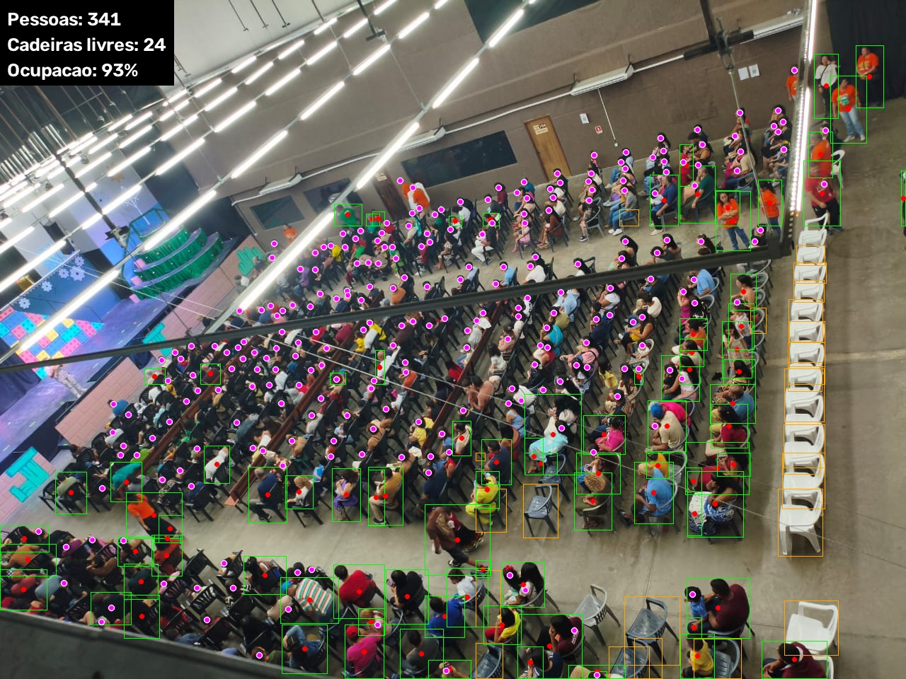
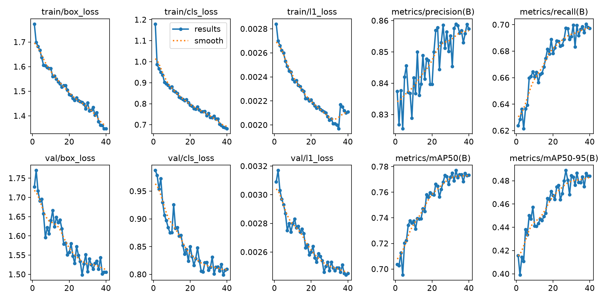

# Contagem de Público

Identifica e conta as pessoas de um auditório a partir de uma **foto**, **vídeo** ou **webcam ao vivo**,
de qualquer ângulo (de cima, de frente, de trás). Também estima **cadeiras livres** e **ocupação**.



## Preparar o ambiente

Usa [uv](https://docs.astral.sh/uv/):

```bash
uv sync
```

Na primeira execução são baixados automaticamente o `yolo26m.pt` (Ultralytics) e os pesos do
[P2PNet](https://github.com/TencentYoutuResearch/CrowdCounting-P2PNet) treinados no ShanghaiTech A (`models/p2pnet_shtech_a.pth`, ~86 MB).

## Passo a passo

| Script | O que faz |
|---|---|
| `01_test_webcam.py` | Abre a webcam com OpenCV e mostra o FPS. Serve para achar o índice certo da câmera. |
| `02_train_heads.py` | Baixa o CrowdHuman, converte as caixas de cabeça para o formato YOLO e treina um YOLO26s detector de cabeças. |
| `03_count_photo.py` | Conta o público em fotos ou pastas, salva as imagens anotadas e um `summary.json` em `output/`. |
| `04_count_webcam.py` | Conta ao vivo em webcam, arquivo de vídeo ou stream RTSP, com média móvel e troca de modo pelo teclado. |
| `audience.py` | Biblioteca: YOLO em blocos, fontes de cabeças, junção, região de interesse, mapa de calor e desenho. |
| `p2pnet.py` | Reimplementação do P2PNet (contagem de multidão por pontos) para carregar os pesos oficiais. |

```bash
uv run 01_test_webcam.py --camera 0
uv run 02_train_heads.py                     # baixa ~5,5 GB e treina (~1h45 numa RTX 3050)
uv run 03_count_photo.py examples
uv run 03_count_photo.py examples --compare     # todos os modos lado a lado
uv run 03_count_photo.py foto.jpg --heatmap --show
uv run 03_count_photo.py foto.jpg --region 0,250,1000,250,1000,667,0,667
uv run 04_count_webcam.py --source 0
uv run 04_count_webcam.py --source video.mp4 --mode p2pnet
uv run 04_count_webcam.py --source rtsp://usuario:senha@ip:554/stream --interval 2
```

Na webcam: `q`/`ESC` sai, `m` troca o modo, `c` liga/desliga o mapa de calor, `s` salva o quadro anotado.
O rodapé mostra o modo, a média móvel e o tempo de cada contagem.

Na imagem anotada: caixa verde com ponto vermelho é pessoa achada pelo YOLO, ponto rosa é cabeça,
caixa laranja é cadeira livre.

### Modos

| Modo | Fontes | Quando usar |
|---|---|---|
| `combined` (padrão com o modelo treinado) | pessoas + cabeças treinadas + P2PNet | Melhor contagem geral. ~1,2 s por quadro. |
| `trained` | pessoas + cabeças treinadas | Público de frente ou de trás, sem cortinas/texturas confusas. |
| `p2pnet` (padrão sem o modelo treinado) | pessoas + P2PNet | Multidão muito densa vista de cima. ~0,4 s por quadro. |
| `people` | só YOLO COCO | Público pequeno e próximo; o mais rápido. |

### Parâmetros principais

| Parâmetro | Padrão | Efeito |
|---|---|---|
| `--mode` | `combined` | Ver tabela acima. |
| `--model` | `yolo26m.pt` | YOLO COCO para pessoas e cadeiras. `n`/`s` mais rápido, `l`/`x` mais preciso. |
| `--head-model` | `runs/heads/weights/best.pt` | Detector de cabeças treinado. |
| `--tile` | `320` | Tamanho dos blocos em que a imagem é dividida para o YOLO. `0` desativa. |
| `--overlap` | `0.3` | Quanto os blocos se sobrepõem, para não perder quem está na borda. |
| `--conf` | `0.25` | Confiança mínima do YOLO de pessoas. |
| `--head-threshold` | `0.5` / `0.25` | Confiança mínima do P2PNet / do detector treinado. Suba se aparecerem cabeças falsas. |
| `--head-scale` | `1.0` | Amplia a imagem antes do P2PNet; ajuda quando as cabeças são minúsculas. |
| `--region` | | Polígono em pixels; só conta quem está dentro dele (ex.: só a plateia, sem o palco). |
| `--heatmap` | | Mapa de calor da densidade de pessoas. |

## Treino do detector de cabeças

O `02_train_heads.py` usa o [CrowdHuman](https://www.crowdhuman.org/) (espelho no
[Hugging Face](https://huggingface.co/datasets/ShantyCam/crowdhuman)), que tem caixas de cabeça (`hbox`) inclusive
de pessoas de costas e parcialmente cobertas. Por padrão usa a parte `train01` (5.000 imagens, ~98 mil cabeças) e
1.000 imagens da validação (~22 mil cabeças). Cabeças marcadas como `ignore` são descartadas.

```bash
uv run 02_train_heads.py --parts train01 train02 train03 --epochs 60   # dataset completo, 15 mil imagens
uv run 02_train_heads.py --model yolo26m.pt --batch 4                   # modelo maior
```

Resultado com os padrões (YOLO26s, 800 px, 40 épocas, 1h45 numa RTX 3050):

| Métrica (validação) | Valor |
|---|---|
| Precisão | 0,85 |
| Recall | 0,70 |
| mAP50 | 0,77 |
| mAP50-95 | 0,49 |



O CrowdHuman é para uso não comercial; os pesos treinados ficam em `runs/` e não vão para o repositório.

## Como funciona

1. **YOLO em blocos (tiling)**: a imagem é cortada em blocos sobrepostos e cada bloco passa pelo YOLO na resolução
   cheia. Um NMS junta as caixas repetidas entre blocos e um segundo filtro remove pedaços de pessoas cortadas na
   borda. O YOLO COCO acha **pessoas grandes e próximas** e **cadeiras**.
2. **Detector de cabeças treinado**: também em blocos (320 px ampliados para 800). Acha cabeças de frente, de costas
   e de perfil, inclusive em primeiro plano, e não confunde cortinas com cabeças.
3. **P2PNet**: rede de contagem de multidões que prevê **um ponto por cabeça**. Acha cabeças minúsculas e muito
   sobrepostas, principalmente em vistas de cima, que o CrowdHuman quase não tem.
4. **Junção**: no modo combinado, pontos do P2PNet dentro (ou perto) de uma cabeça já detectada são descartados.
   Depois, cada pessoa do YOLO "consome" no máximo uma cabeça na região do topo da caixa. O total é pessoas + cabeças
   que sobraram, então ninguém é contado duas vezes e quem aparece atrás de outra pessoa continua contando.
5. **Cadeiras e ocupação**: cadeira sem pessoa nem cabeça sobre ela é livre; ocupação = pessoas / (pessoas + cadeiras livres).

Nas fotos de `examples/` (`uv run 03_count_photo.py examples --compare`):

| Foto | people | p2pnet | trained | combined |
|---|---|---|---|---|
| `auditorium_1.jpg` (de cima, muito denso) | 92 | 298 | 261 | 341 |
| `auditorium_2.jpg` (de frente) | 53 | 163 | 124 | 164 |
| `auditorium_3.jpg` (de trás) | 69 | 97 | 102 | 102 |
| `auditorium_4.jpg` (de trás, perto) | 13 | 22 | 17 | 18 |

Na foto 4 o P2PNet conta alguns pontos falsos na cortina; o treinado e o combinado não.

## Limitações e próximos passos

- As fotos de exemplo não têm contagem manual, então os números acima comparam os modos entre si, não com o valor real.
  Anotar algumas fotos do próprio auditório permitiria medir o erro de verdade.
- Cabeças muito pequenas e escuras sobre fundo escuro ainda escapam.
- Fine-tuning do detector de cabeças com fotos do próprio auditório (vista de cima) deve melhorar bastante.
- Exportar para TensorRT (`model.export(format="engine")`) para acelerar a webcam.
