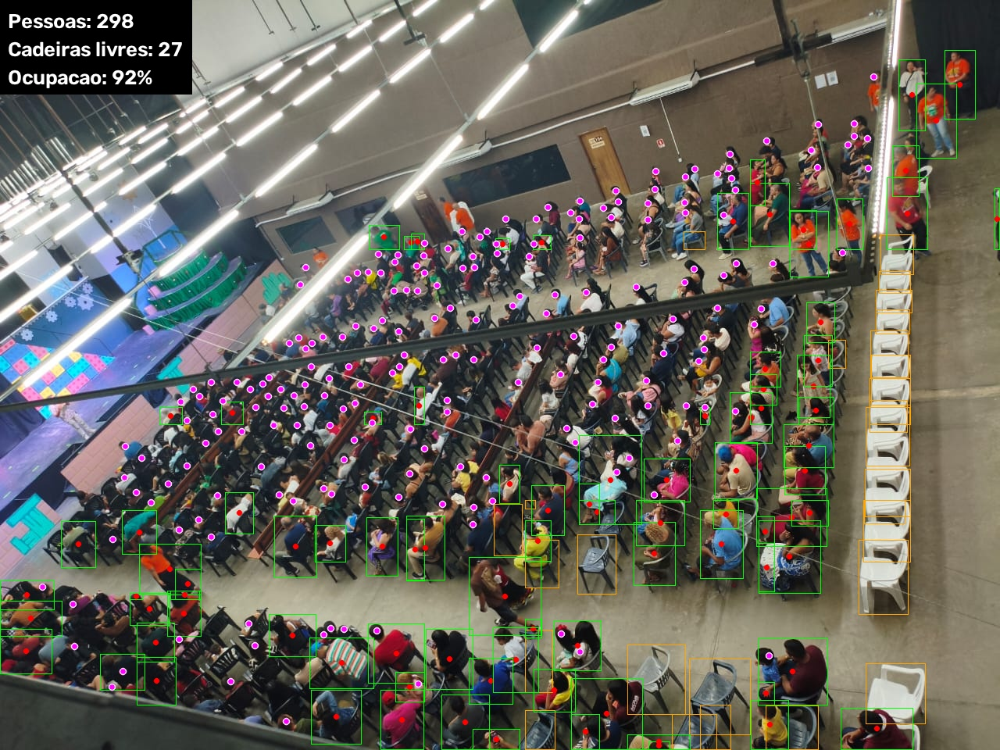

# Contagem de Público

Identifica e conta as pessoas de um auditório a partir de uma **foto**, **vídeo** ou **câmera ao vivo**,
de qualquer ângulo (de cima, de frente, de trás). Também estima **cadeiras livres** e **ocupação**.



## Preparar o ambiente

Usa [uv](https://docs.astral.sh/uv/):

```bash
uv sync
```

Na primeira execução são baixados automaticamente o `yolo26m.pt` (Ultralytics) e os pesos do
[P2PNet](https://github.com/TencentYoutuResearch/CrowdCounting-P2PNet) treinados no ShanghaiTech A (`modelos/p2pnet_shtech_a.pth`, ~86 MB).

## Uso

| Script | O que faz |
|---|---|
| `contar_foto.py` | Conta o público em uma ou várias fotos (ou pastas) e salva as imagens anotadas em `saida/` com um `resumo.json`. |
| `contar_camera.py` | Conta ao vivo em webcam, arquivo de vídeo ou stream RTSP, com média móvel da contagem. |
| `publico.py` | Biblioteca: YOLO em blocos, junção com o P2PNet, região de interesse, mapa de calor e desenho. |
| `p2pnet.py` | Reimplementação do P2PNet (contagem de multidão por pontos) para carregar os pesos oficiais. |

```bash
uv run contar_foto.py exemplos
uv run contar_foto.py exemplos/auditorio_1.jpg --calor --mostrar
uv run contar_foto.py foto.jpg --regiao 0,250,1000,250,1000,667,0,667
uv run contar_camera.py --fonte 0
uv run contar_camera.py --fonte rtsp://usuario:senha@ip:554/stream --intervalo 2
```

Na câmera: `q`/`ESC` sai, `c` liga/desliga o mapa de calor, `s` salva o quadro anotado.

Na imagem anotada: caixa verde com ponto vermelho é pessoa achada pelo YOLO, ponto rosa é cabeça achada pelo P2PNet,
caixa laranja é cadeira livre.

### Parâmetros principais

| Parâmetro | Padrão | Efeito |
|---|---|---|
| `--modelo` | `yolo26m.pt` | `n`/`s` mais rápido, `l`/`x` mais preciso. |
| `--bloco` | `320` | Tamanho dos blocos em que a imagem é dividida para o YOLO. `0` desativa. |
| `--sobreposicao` | `0.3` | Quanto os blocos se sobrepõem, para não perder quem está na borda. |
| `--conf` | `0.25` | Confiança mínima do YOLO. |
| `--limiar-cabeca` | `0.5` | Confiança mínima dos pontos do P2PNet. Suba se aparecerem cabeças falsas em paredes e cortinas. |
| `--escala-cabeca` | `1.0` | Amplia a imagem antes do P2PNet; ajuda quando as cabeças são minúsculas. |
| `--sem-densidade` | | Usa só o YOLO. |
| `--regiao` | | Polígono em pixels; só conta quem está dentro dele (ex.: só a plateia, sem o palco). |
| `--calor` | | Mapa de calor da densidade de pessoas. |

## Como funciona

A contagem é **híbrida**, porque nenhum modelo sozinho funciona bem em todas as vistas:

1. **YOLO em blocos (tiling)**: a imagem é cortada em blocos sobrepostos e cada bloco passa pelo YOLO na resolução
   cheia. Um NMS junta as caixas repetidas entre blocos e um segundo filtro remove pedaços de pessoas cortadas na
   borda. É bom para pessoas **grandes e próximas** da câmera.
2. **P2PNet**: rede de contagem de multidões que, em vez de caixas, prevê **um ponto por cabeça**. Treinada em
   multidões densas, acha cabeças pequenas, de costas e muito sobrepostas, onde o YOLO falha.
3. **Junção**: cada caixa do YOLO "consome" no máximo um ponto do P2PNet na região da cabeça (o mais próximo do topo
   da caixa). O total é caixas + pontos que sobraram. Assim a mesma pessoa não é contada duas vezes e as pessoas de
   trás que aparecem dentro da caixa de quem está na frente continuam contando.
4. **Cadeiras e ocupação**: o YOLO também detecta `chair`. Cadeira sem pessoa nem cabeça sobre ela é considerada
   livre; ocupação = pessoas / (pessoas + cadeiras livres).

Nas fotos de `exemplos/`:

| Foto | Só YOLO | Híbrido |
|---|---|---|
| `auditorio_1.jpg` (de cima, muito denso) | 92 | 298 |
| `auditorio_2.jpg` (de frente) | 53 | 163 |
| `auditorio_3.jpg` (de trás) | 69 | 97 |
| `auditorio_4.jpg` (de trás, perto) | 13 | 22 |

Numa RTX 3050 o híbrido leva ~0,4 s por quadro de 1280×960.

## Limitações e próximos passos

- Cabeças **muito grandes** em primeiro plano, cortadas pela borda da foto, às vezes não são contadas por nenhum dos dois.
- Superfícies com textura parecida com cabeças (cortinas, plateias desenhadas) podem gerar pontos falsos; use
  `--regiao` ou suba `--limiar-cabeca`.
- Fine-tuning do P2PNet ou de um detector de cabeças com fotos do próprio auditório deve melhorar bastante.
- Exportar para TensorRT para acelerar a câmera ao vivo.
